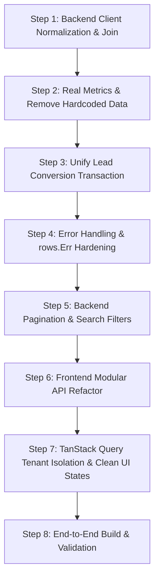

# Architecture Review & Refactoring Plan: Photography CRM

## 1. Executive Summary & Verification of Findings

We analyzed the current codebase against each point raised in the audit. Here is the verified state of the system:

| Topic | Current State in Codebase | Recommended Direction |
| :--- | :--- | :--- |
| **Client Redundancy in Project DTO** | `projects` table & `ProjectDTO` duplicate `clientName`, `clientInitials`, `clientMobile`, `clientCountryCode`, `clientEmail`, `clientAddress`. The schema has a `clients` table, but `client_id` is loosely populated or omitted. | Maintain a dedicated `clients` table as single source of truth. Projects & Leads link via `client_id`. Project DTO joins or snapshots deliberate historical contracts where required. |
| **Hardcoded Backend Mock Values** | `projects_handler.go` lines 181 & 322 hardcode: `TasksCount: map[string]int{"completed": 1, "total": 3}`, `DeliverablesCount: map[string]int{"ready": 1, "total": 2}`. Lines 133 & 400 hardcode `Rohan Mehta` (`RM`). | Compute real task counts and deliverable counts from project JSON/relational rows. Fetch project managers from assigned crew/users or return `null`/empty structure. |
| **Persistence & Architecture Divergence** | The prompt notes mixed use of `database/sql`, `sqlx`, and `sqlc`. Crucially, project rules state: *"No migrations, No models, use DB queries directly"*, *"Prefer raw SQL queries"*, *"database/sql as underlying driver"*. There is also duplicate lead conversion in `services/crm_service.go` vs `handlers/leads_handler.go`. | Unify backend on clean direct parameterized raw SQL using `database/sql` via `utils.DBFromContext`. Consolidate lead conversion into a single canonical workflow. Avoid unnecessary abstractions while keeping logic clean and robust. |
| **Silent Error Swallowing & Scanning Bugs** | Ubiquitous `if err := rows.Scan(...); err == nil { ... }` in `billing_handler.go`, `crew_handler.go`, `deliverables_handler.go`, `packages_handler.go`, `roles_handler.go`, `services_handler.go`, `workflow_handler.go`. Ubiquitous `_ = json.Unmarshal(...)` across handlers. Missing `rows.Err()` checks. | Replace with explicit scanning and error logging/return. Check `rows.Err()`. Explicitly handle JSON unmarshal/marshal failures. Validate `RowsAffected()` on updates/deletes. Return accurate HTTP status codes (400, 404, 409, 500). |
| **List Query Scalability & Pagination** | List handlers (`projects`, `leads`, `sessions`, `orders`, `billing_*`) execute unpaginated `SELECT *` without `LIMIT`, `OFFSET`, search filters, or deterministic ordering. | Introduce consistent pagination parameters (`page`, `pageSize` with max limit e.g. 100), deterministic sorting (`ORDER BY created_at DESC, id DESC`), multi-tenant filtering (`tenant_id = ?`), and search filters. |
| **Frontend Architecture & TanStack Query** | Frontend in `frontend/apps/photography_crm/` mixes `crmApi.ts` direct `fetch` calls, sporadic React component state, custom hooks, and mock fallbacks. Query keys lack tenant scoping (`['projects']` instead of `['projects', tenantId]`). Single mega-file `crmApi.ts` instead of modular API clients. | Reorganize `src/api/` into clean, typed endpoint modules (`leadsApi.ts`, `clientsApi.ts`, `projectsApi.ts`, `sessionsApi.ts`, `ordersApi.ts`, `billingApi.ts`, etc.). Standardize on TanStack Query hooks keyed by `[domain, tenantId, params]`. Enforce proper loading, empty, error, and success states across pages without mock fallback. |

---

## 2. In-Depth Architectural Assessment

### 2.1 Domain & Data Model: Client vs. Project & Lead
- **The Problem:** 
  In `projects/photography_crm/handlers/projects_handler.go` and `docker/volumes/mysql/initdb/01_schema.sql`, the `projects` table has:
  ```sql
  client_id, client_name, client_mobile, client_email, client_address, client_country_code, client_initials
  ```
  Updating a client's email or phone in one place does not propagate to their other projects or leads, causing split-brain client records.
- **The Solution:**
  1. Ensure every lead conversion or direct project creation links to a valid row in `clients (id, tenant_id, first_name, last_name, email, phone, ...)`.
  2. For queries, `LEFT JOIN clients c ON p.client_id = c.id` to read live client information.
  3. Where an immutable snapshot is legally/contractually necessary (e.g. final billed invoice snapshot or contract execution), snapshot it explicitly in an `invoice_snapshot` or `contract_snapshot` JSON column rather than duplicating mutable operational fields.

### 2.2 Hardcoded Mock Data Elimination
- **Tasks Count:** Currently hardcoded to completed: 1, total: 3.
  - In `projects`, tasks can be stored in the project's `tasks` JSON column or derived. Calculate `completed` and `total` dynamically:
    ```go
    completed := 0
    total := len(tasks)
    for _, t := range tasks {
        if t.Status == "completed" || t.Completed {
            completed++
        }
    }
    ```
- **Deliverables Count:** Currently hardcoded to ready: 1, total: 2.
  - Parse the project's `deliverables` JSON array or relational deliverables to count actual ready vs total items.
- **Project Manager:** Currently defaults to `Rohan Mehta` (`RM`).
  - If no manager is assigned to the project or lead, return `null` (`nil`) or an empty object `{}`. If assigned via `project_manager_id` or user ID, fetch user details from `users`.

### 2.3 Persistence Strategy Alignment with Project Rules
The user prompt recommended sqlc/services/repositories, but the project's strict rules state:
> **Rules:**
> 1. *"No migrations, No models, use DB queries directly"*
> 2. *"Keep handlers straightforward. Do not add DTO mappers, validator layers, service layers, repository interfaces, or other indirection for a simple CRUD endpoint unless the feature has a concrete need for them."*
> 3. *"Prefer raw SQL queries"*
> 4. *"database/sql as the underlying driver abstraction"*

- **Decision:** Align with the project rules. Use clean, direct parameterized SQL via standard `database/sql` (`utils.DBFromContext(r.Context(), nil)`).
- **Lead Conversion Unification:**
  Eliminate the duplicate lead conversion code between `CRMService.ConvertLeadToClient` and `handlers/leads_handler.go:ConvertLeadHandler`. Centralize the full transactional conversion logic into a clean, reusable function that runs a single SQL transaction:
  1. Read lead details.
  2. Find or create the `client` record.
  3. Create the `project` record referencing `client_id`.
  4. Update `leads.status = 'converted'`, `converted_client_id`, `converted_project_id`.
  5. Commit transaction.

### 2.4 Error Handling & Robustness Hardening
- **Scan Errors:**
  Replace:
  ```go
  for rows.Next() {
      if err := rows.Scan(...); err == nil {
          items = append(items, item)
      }
  }
  ```
  With:
  ```go
  for rows.Next() {
      if err := rows.Scan(...); err != nil {
          utils.WriteJSON(w, http.StatusInternalServerError, map[string]string{"error": "Failed to read data"})
          return
      }
      items = append(items, item)
  }
  if err := rows.Err(); err != nil {
      utils.WriteJSON(w, http.StatusInternalServerError, map[string]string{"error": "Error iterating results"})
      return
  }
  ```
- **JSON Handling:**
  Never use `_ = json.Unmarshal(...)`. Check unmarshal errors; if data in DB is null or empty string, initialize empty slices or handle invalid JSON gracefully with informative logging.
- **Execution & Mutation Checks:**
  Check `result.RowsAffected()`. Return `http.StatusNotFound` (404) if no rows were updated/deleted, rather than claiming 200 OK.

### 2.5 List Pagination, Ordering, Filtering & Indexing
- Standardize all list endpoints (`/api/projects`, `/api/leads`, `/api/sessions`, `/api/orders`, `/api/billing/*`, `/api/clients`):
  - `page`: default 1
  - `pageSize`: default 20, max 100
  - `status`: optional filter
  - `search`: search by name, email, phone with parameterized `LIKE`
  - Deterministic sort: `ORDER BY created_at DESC, id DESC`
  - Response metadata:
    ```json
    {
      "data": [...],
      "pagination": {
        "page": 1,
        "pageSize": 20,
        "total": 45,
        "totalPages": 3
      }
    }
    ```

### 2.6 Frontend State, Modular API & TanStack Query
- **Modular API client in `frontend/apps/photography_crm/src/api/`:**
  - `leadsApi.ts`
  - `clientsApi.ts`
  - `projectsApi.ts`
  - `sessionsApi.ts`
  - `ordersApi.ts`
  - `billingApi.ts`
  - `settingsApi.ts`
  - `crewApi.ts`
  - `deliverablesApi.ts`
- **Tenant-Scoped TanStack Query Keys:**
  Ensure queries include active tenant ID:
  ```ts
  useQuery({
    queryKey: ['projects', tenantId, { page, pageSize, search, status }],
    queryFn: () => projectsApi.list({ page, pageSize, search, status }),
    enabled: !!tenantId,
  })
  ```
- **UI State Discipline:**
  - Distinct state rendering: Loading spinner/skeleton, Empty state (no fallback to fake demo data), Error state with retry button, and Success list/table.

---

## 3. Step-by-Step Implementation Roadmap



### Phase 1: Backend Database & Handlers Refactor
1. **Projects & Leads Client Unification:**
   - Update `projects_handler.go`: Query joins `clients` on `p.client_id = c.id` (with fallback to project columns if legacy unlinked records exist).
   - Return clean `ProjectDTO` where client contact details are derived from the client record.
2. **Remove Hardcoded Mock Data:**
   - In `projects_handler.go`, compute `tasksCount` and `deliverablesCount` from the project's actual segments/tasks/deliverables JSON payloads.
   - For `project_manager`, return `null` when not set, or the actual stored manager.
3. **Consolidate Lead Conversion:**
   - Remove duplicate conversion paths. Make `leads_handler.go:ConvertLeadHandler` execute a single clean transactional flow creating or linking a `client` and generating the `project`.
4. **Fix Error Swallowing & Scan Logic:**
   - Fix all handlers: `billing_handler.go`, `crew_handler.go`, `deliverables_handler.go`, `order_presets_handler.go`, `packages_handler.go`, `roles_handler.go`, `services_handler.go`, `settings_handler.go`, `workflow_handler.go`, `sessions_handler.go`, `leads_handler.go`, `projects_handler.go`.
   - Add `rows.Err()` check and scan error handling.
5. **Add List Pagination & Search:**
   - Add query parameter parsing (`page`, `pageSize`, `search`, `status`) to list endpoints.
   - Return structured pagination responses with backward compatibility.

### Phase 2: Frontend Architecture Refactor
1. **Create Modular API Files in `src/api/`:**
   - Deconstruct `crmApi.ts` into individual typed modules: `leadsApi.ts`, `projectsApi.ts`, `clientsApi.ts`, `sessionsApi.ts`, `ordersApi.ts`, `billingApi.ts`, `settingsApi.ts`, `crewApi.ts`, `deliverablesApi.ts`.
2. **TanStack Query Hooks with Tenant Scoping:**
   - Update query hooks to include `tenantId` in `queryKey`.
   - Implement query cache invalidation on workspace switch.
3. **Replace Fake Fallbacks with Explicit States:**
   - In pages (`ProjectsPage`, `LeadsPage`, `OrdersPage`, `BillingsPage`, etc.), display proper Loading, Empty, and Error states.

---

## 4. Verification & Testing Strategy
- Compile check backend with `go build ./projects/photography_crm/...`
- Compile check frontend with `pnpm --filter photography_crm build` / TypeScript typecheck `tsc --noEmit`
- Verify API contracts against existing tests in `tests/photography_crm/`
