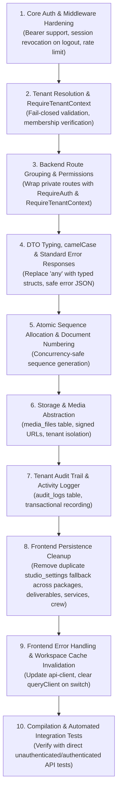

# Remediation & Hardening Plan: Photography CRM Backend & Frontend

## Overview
This plan addresses the critical security vulnerabilities, architectural inconsistencies, and frontend data persistence issues identified in `projects/photography_crm` and shared platform modules.

---

## 1. Authentication & Route Protection

### Current State
In [projects/photography_crm/routes/backend.go](file:///home/desktop/especa/beta/projects/photography_crm/routes/backend.go), business routes (`/api/leads`, `/api/projects`, `/api/sessions`, `/api/orders`, `/api/billing`, `/api/settings`, `/api/roles`, `/api/crew`, `/api/workflows`, etc.) are mounted directly on the router without `RequireAuth`. In addition, duplicated route registrations exist at lines 145–177. Direct API requests using `Authorization: Bearer <token>` are ignored because `authenticate()` in [projects/core/middleware/middleware.go](file:///home/desktop/especa/beta/projects/core/middleware/middleware.go#L213-L240) only inspects session cookies.

### Proposed Changes
1. **Public vs Private Route Separation**:
   - Keep public endpoints outside authenticated route groups:
     - Health: `GET /api/health`
     - Frontend error logs: `POST /api/logs/frontend`
     - Public Auth: `GET /api/auth/csrf`, `POST /api/auth/login`, `POST /api/auth/signup`, `POST /api/auth/register-business`
   - Group all tenant-owned business routes inside a subrouter protected with:
     ```go
     r.Group(func(api chi.Router) {
         api.Use(middleware.RequireAuth(cfg))
         api.Use(middleware.RequireTenantContext)
         // business routes
     })
     ```
2. **Support Direct API Requests (Headless & External Clients)**:
   - Update `authenticate()` in `middleware.go` to inspect the `Authorization: Bearer <token>` header in addition to session cookies.
   - When a valid Bearer token is provided, verify it against the session secret and check token revocation version just like cookies.
3. **Role & Permission Checks**:
   - Apply permission middleware (`middleware.RequireRole("admin")` or tenant admin role checks) on sensitive operations:
     - Billing cancellations, deletions, and refunds (`/api/billing/cancelled`, `/api/billing/refunds`, DELETE operations).
     - System & Studio settings mutations (`POST /api/settings`, `POST /api/sequence-id`).
     - Role creation and deletion (`/api/roles`).
4. **Clean Duplicate Route Registrations**:
   - Remove redundant registrations of `/api/crew`, `/api/sequence-id`, `/api/services`, `/api/deliverables`, `/api/packages` in `backend.go`.

---

## 2. Fail-Closed Tenant Resolution

### Current State
`getTenantID()` in [projects/photography_crm/handlers/workflow_handler.go](file:///home/desktop/especa/beta/projects/photography_crm/handlers/workflow_handler.go#L25-L41) allows any arbitrary UUID in an `active_tenant_id` cookie, falls back to the first active tenant in MySQL, and finally falls back to a hardcoded UUID `"018e0000-0001-7000-8000-000000000020"`.

### Proposed Changes
1. **Remove Unsafe Fallbacks**:
   - Completely delete the arbitrary DB query fallback (`SELECT id FROM tenants WHERE status = 'active' LIMIT 1`) and the hardcoded UUID fallback.
2. **Implement `RequireTenantContext` Middleware**:
   - Resolve target tenant ID from `active_tenant_id` cookie or `X-Tenant-ID` header.
   - Query user's memberships via direct parameterized query (`SELECT tenant_id, role, status FROM memberships WHERE user_id = ? AND status = 'active' AND deleted_at IS NULL`).
   - Validate that the target tenant ID belongs to the authenticated user's active memberships.
   - If no specific tenant requested, select the user's primary/first active membership.
   - If the user has no active memberships or requests an unauthorized tenant, immediately abort with HTTP 403 Forbidden (`{ "error": { "code": "FORBIDDEN", "message": "Access denied to workspace" } }`).
   - Inject resolved `TenantContext` into request context.
3. **Handler Refactoring**:
   - Update all photography CRM handlers to obtain the tenant ID strictly via `utils.TenantFromContext(r.Context())`. If missing, reject immediately.

---

## 3. Workspace Switching Guarantees

### Current State
[projects/photography_crm/handlers/workspace_handler.go](file:///home/desktop/especa/beta/projects/photography_crm/handlers/workspace_handler.go) contains `SwitchTenantHandler` (redirect-based and not registered in Chi) and `WorkspacesAPIHandler`. The frontend does not currently provide a unified switch workflow that clears workspace cache.

### Proposed Changes
1. **API Endpoints**:
   - `GET /api/auth/workspaces`: returns active tenant ID and list of authorized active workspaces with roles.
   - `POST /api/auth/switch-workspace`: accepts `{ "tenantId": "..." }`.
     - Validates authenticated user membership and status in target tenant.
     - Sets `active_tenant_id` cookie: `HttpOnly=true`, `SameSite=Lax`, `Secure=cfg.SessionSecure`, `Path="/"`.
     - Returns `{ "activeTenantId": "...", "workspace": { ... } }`.
2. **Frontend Workspace Switcher & Cache Clearing**:
   - Connect sidebar studio selector or dropdown to `/api/auth/workspaces` and `/api/auth/switch-workspace`.
   - On successful switch, invalidate and clear React Query cache (`queryClient.clear()`) and reset local stores to prevent state bleeding between workspaces.

---

## 4. Tenant-Aware Role Management

### Current State
[projects/photography_crm/handlers/roles_handler.go](file:///home/desktop/especa/beta/projects/photography_crm/handlers/roles_handler.go) queries and mutates the global `roles` table directly. Unauthenticated or non-admin users could create or delete roles.

### Proposed Changes
1. **Separation of System Roles vs Custom Roles**:
   - Protect global/system roles (`admin`, standard photography designations) from modification or deletion.
   - Scope studio custom roles and designations to tenant or memberships table.
2. **Authorization Enforcement**:
   - Restrict role creation/deletion to tenant administrators (`middleware.RequireRole("admin")`).
   - Prevent self-promotion: regular members cannot assign higher-privilege roles to themselves or colleagues.

---

## 5. Session and Cookie Security

### Current State
- `LogoutAPIHandler` in [projects/core/handlers/handlers.go](file:///home/desktop/especa/beta/projects/core/handlers/handlers.go#L225) only expires the cookie on the browser without revoking the token in MySQL.
- No rate limiting exists on `/api/auth/login` or `/api/auth/signup`.
- Production secret requirements are in place in `LoadConfig`, but verification of cookie attributes and rotation needs consistency.

### Proposed Changes
1. **Session Revocation on Logout**:
   - In `LogoutAPIHandler`, increment `token_version` on the user record in MySQL (`UPDATE users SET token_version = token_version + 1 WHERE id = ?`).
   - Clear session cookie and `active_tenant_id` cookie.
2. **Login/Signup Rate Limiting**:
   - Implement an in-memory sliding-window rate limiter middleware for `/api/auth/login` and `/api/auth/signup` (e.g., maximum 5 failed attempts per minute per IP).
3. **Cookie Attributes**:
   - Verify `HttpOnly: true`, `SameSite: Lax`, and `Secure: cfg.SessionSecure` on all authentication and tenant cookies.

---

## 6. DTO & JSON Naming Standardization (camelCase)

### Current State
The backend mixes `camelCase` and `snake_case` in DTOs (e.g. `PackageItem` uses `totalCost` alongside `tenant_id`, `CrewMemberItem` uses `fullName` and `role_id`, `ServiceGroupItem` uses `group_name`).

### Proposed Changes
1. **Convert all public JSON API properties to `camelCase`**:
   - `tenant_id` -> `tenantId`
   - `role_id` -> `roleId`
   - `group_name` -> `groupName`
   - `order_number` -> `orderNumber`
2. **Sync Frontend TypeScript Types**:
   - Update interfaces in `frontend/apps/photography_crm/src/types/` (`settings.ts`, `order.ts`, `project.ts`, `lead.ts`, `billing.ts`) to match camelCase DTOs.

---

## 7. Typing and Nullable Fields Policy

### Current State
Wide usage of `any` in DTOs (`ProjectDTO`, `OrderDTO`, `PackageItem`, `ServiceGroupItem`, `DeliverableGroupItem`) and uncontrolled `omitempty` vs `""` vs `null`.

### Proposed Changes
1. **Explicit Go Structs**:
   - `ServiceItemDTO`: `id`, `name`, `cost`, `quantity`, `isCustom`
   - `ServiceGroupDTO`: `id`, `groupName`, `services: []ServiceItemDTO`
   - `DeliverableItemDTO`: `id`, `name`, `groupName`
   - `DeliverableGroupDTO`: `id`, `groupName`, `deliverables: []DeliverableItemDTO`
   - `PackageServiceGroupDTO`: `id`, `groupName`, `quantity`, `services: []PackageServiceItemDTO`
   - `PackageDTO`: `id`, `name`, `description`, `totalCost`, `serviceGroups: []PackageServiceGroupDTO`, `deliverables: []string`
2. **Nullability Contract**:
   - Empty collections return empty JSON arrays `[]` rather than `null`.
   - Optional fields use typed pointers (e.g., `*string`, `*int64`) or explicit non-empty strings.

---

## 8. Standardize Error Responses

### Current State
Handlers return inconsistent formats: `{"error": "string"}`, `{"error": err.Error()}` (leaking raw SQL), or `ErrorResponse{Error, ErrorID}`.

### Proposed Changes
1. **Backend Error Format**:
   - Standardize error responses to:
     ```json
     {
       "error": {
         "code": "VALIDATION_ERROR",
         "message": "Project name is required",
         "fields": {
           "projectName": "Required"
         }
       }
     }
     ```
   - Never expose raw SQL errors to clients. Log errors on the server with request ID and return safe messages.
2. **Frontend `api-client.ts` Update**:
   - Ensure `apiClient` transparently extracts `error.message` from `{ error: { code, message } }` as well as backward-compatible string error formats.

---

## 9. Frontend Persistence & Single Source of Truth

### Current State
Several settings pages (`PackagesSettingsPage`, `DeliverablesSettingsPage`, `ServicesSettingsPage`, `PhotographersPage`, `SequenceIdPage`) implement dual persistence: saving to dedicated API endpoints while also writing to generic `studio_settings`, and falling back to sample or mock data.

### Proposed Changes
1. **Packages ([PackagesSettingsPage.tsx](file:///home/desktop/especa/beta/frontend/apps/photography_crm/src/pages/settings/PackagesSettingsPage.tsx))**:
   - Remove `SAMPLE_PACKAGES` from production initial state.
   - Use `/api/packages` as the sole source of truth; eliminate `settingsApi` fallback.
   - Only update local UI state upon confirmed HTTP 2xx response from backend.
   - Add proper loading skeleton, error banner, and empty state.
2. **Deliverables ([DeliverablesSettingsPage.tsx](file:///home/desktop/especa/beta/frontend/apps/photography_crm/src/pages/settings/DeliverablesSettingsPage.tsx))**:
   - Use `/api/deliverables` exclusively; remove `deliverablesPresets` and `deliverableGroups` persistence in `studio_settings`.
   - Batch operations must be atomic.
   - Revert optimistic UI state if save fails and display error toast.
3. **Services ([ServicesSettingsPage.tsx](file:///home/desktop/especa/beta/frontend/apps/photography_crm/src/pages/settings/ServicesSettingsPage.tsx))**:
   - Remove static fallback costs (`cost: s.amount || s.cost || 200`) and hardcoded default services.
   - Load services and categories exclusively from `/api/services`.
   - Remove duplicate persistence to `studio_settings`.
4. **Crew / Photographers ([PhotographersPage.tsx](file:///home/desktop/especa/beta/frontend/apps/photography_crm/src/pages/settings/PhotographersPage.tsx))**:
   - Persist crew via `/api/crew` and designations via `/api/roles`.
   - Remove fallback to `settingsApi.updateSettings({ crewMembers })`.
5. **Atomic Sequence ID Generation ([SequenceIdPage.tsx](file:///home/desktop/especa/beta/frontend/apps/photography_crm/src/pages/settings/SequenceIdPage.tsx) & [sequence_id_handler.go](file:///home/desktop/especa/beta/projects/photography_crm/handlers/sequence_id_handler.go))**:
   - Dedicated `sequence_id` table as sole source of truth.
   - Implement atomic number allocation via database transaction with row-level lock (`SELECT ... FOR UPDATE` or atomic increment) to prevent race conditions during concurrent document creation.
   - Enforce database-level uniqueness constraints on document numbers per tenant.

---

## 10. File, Media & Storage Management

### Context & Goals
The Photography CRM handles sensitive client media (RAW photographs, high-res proofs, color-graded deliverables, highlight reels), as well as business documents (signed client contracts, quotation PDFs, tax invoices, vendor receipts).
Binary contents must not be stored directly inside relational tables. Instead, MySQL stores rich, tenant-scoped metadata, while files reside in private object storage (e.g. S3-compatible, Cloud Storage, or MinIO) accessed exclusively via short-lived signed URLs.

### 1. Metadata Schema Design (`media_files`)
Store file metadata in MySQL with strict tenant ownership and polymorphic association:

```sql
CREATE TABLE IF NOT EXISTS `media_files` (
    `id` VARCHAR(36) NOT NULL PRIMARY KEY,
    `tenant_id` VARCHAR(36) NOT NULL,
    `owner_type` VARCHAR(50) NOT NULL, -- 'client', 'lead', 'project', 'session', 'order', 'deliverable', 'contract', 'invoice', 'expense'
    `owner_id` VARCHAR(36) NOT NULL,
    `file_name` VARCHAR(255) NOT NULL,
    `storage_key` VARCHAR(512) NOT NULL,
    `content_type` VARCHAR(100) NOT NULL,
    `file_size` BIGINT NOT NULL,
    `checksum` VARCHAR(64) NOT NULL DEFAULT '', -- SHA-256 for integrity verification
    `storage_provider` VARCHAR(50) NOT NULL DEFAULT 's3',
    `visibility` VARCHAR(20) NOT NULL DEFAULT 'private', -- 'private', 'shared_client', 'public_proof'
    `metadata` JSON DEFAULT NULL, -- camera EXIF, resolution, dimensions, color profile
    `uploaded_by` VARCHAR(36) NOT NULL,
    `created_at` DATETIME(6) NOT NULL DEFAULT CURRENT_TIMESTAMP(6),
    `updated_at` DATETIME(6) NOT NULL DEFAULT CURRENT_TIMESTAMP(6) ON UPDATE CURRENT_TIMESTAMP(6),
    `deleted_at` DATETIME(6) DEFAULT NULL,
    INDEX `idx_media_tenant_owner` (`tenant_id`, `owner_type`, `owner_id`),
    INDEX `idx_media_storage_key` (`tenant_id`, `storage_key`),
    CONSTRAINT `fk_media_tenant` FOREIGN KEY (`tenant_id`) REFERENCES `tenants` (`id`) ON DELETE CASCADE
) ENGINE=InnoDB;
```

### 2. Entity Association Model
Files link to core entities via `(owner_type, owner_id)` with parent tenant validation:
- **Clients**: Identity documents, signed client master agreements.
- **Leads**: Attached inquiry briefs, reference mood boards.
- **Projects**: Project contracts, raw shoot packages, master deliverable sets.
- **Sessions**: Session proof galleries, photographer shoot uploads, day logs.
- **Orders**: Physical photobook print proofs, frame layouts.
- **Deliverables**: Client soft-copy galleries, finished video teasers, zip archives.
- **Billing / Invoices**: Generated PDF invoices, payment remittance slips, vendor receipts.

### 3. Storage Abstraction Contract
Define a clean Go interface in `core/storage` so local disk, MinIO, AWS S3, or Google Cloud Storage can be swapped without modifying business handlers:

```go
type StorageProvider interface {
    GenerateUploadURL(ctx context.Context, key string, contentType string, expires time.Duration) (string, error)
    GenerateDownloadURL(ctx context.Context, key string, fileName string, expires time.Duration) (string, error)
    DeleteObject(ctx context.Context, key string) error
    ObjectExists(ctx context.Context, key string) (bool, error)
}
```

### 4. Controlled Access & Signed URLs
- **Private by Default**: Storage buckets forbid public read permissions.
- **Signed Download URLs**: Handlers verify the user's tenant membership and entity permissions before generating an HMAC-signed URL with short TTL (e.g. 15 minutes).
- **Direct Upload Flow**: Handlers authorize the upload, create a pending metadata record, and issue a presigned PUT URL directly to object storage, avoiding piping large multi-gigabyte media through the application server.
- **No Permanent Public URLs**: Never persist permanent unauthenticated storage URLs in database columns or API responses.

### 5. Validation & Security Gates
- **Upload Constraints**:
  - Maximum upload size enforcement (e.g. 50 MB for documents, 2 GB for media archives).
  - Extension and MIME type whitelist (e.g. `image/jpeg`, `image/png`, `image/webp`, `application/pdf`, `video/mp4`).
  - Sniff initial magic bytes on completion or validation endpoint to prevent extension spoofing.
- **Tenant Isolation**: Object keys strictly prefixed with tenant ID: `tenants/{tenant_id}/{owner_type}/{owner_id}/{uuid}_{sanitized_file_name}`. Handlers query records strictly with `WHERE tenant_id = ?`.

### 6. Thumbnails, Previews & Archival
- **Separate Derivative Keys**: Thumbnails and preview low-res proxies use separate storage keys referenced in `metadata` JSON (e.g. `{"thumbnailKey": "...", "previewKey": "..."}`) rather than overwriting the original master copy.
- **Retention & Soft Deletion**: File records use soft delete (`deleted_at`). A background cleanup routine purges soft-deleted object keys from storage after the retention window (e.g. 30 days) expires.

---

## 11. Business Audit Trail & Activity History

### Context & Goals
Critical business decisions and data mutations in the photography CRM (financial records, pricing changes, stage conversions, role allocations) require an immutable, tenant-scoped audit trail separate from operational/debug logging.

### 1. Audit Trail Schema (`audit_logs`)
Store append-only structured audit events in MySQL:

```sql
CREATE TABLE IF NOT EXISTS `audit_logs` (
    `id` VARCHAR(36) NOT NULL PRIMARY KEY,
    `tenant_id` VARCHAR(36) NOT NULL,
    `actor_user_id` VARCHAR(36) NOT NULL,
    `entity_type` VARCHAR(50) NOT NULL, -- 'lead', 'client', 'project', 'session', 'order', 'invoice', 'payment', 'expense', 'crew', 'role', 'settings'
    `entity_id` VARCHAR(36) NOT NULL,
    `action` VARCHAR(50) NOT NULL, -- 'created', 'updated', 'deleted', 'status_changed', 'converted', 'cancelled', 'refunded', 'assigned'
    `changes` JSON DEFAULT NULL, -- structured { "before": { ... }, "after": { ... } }
    `metadata` JSON DEFAULT NULL, -- client IP, user agent, reason notes
    `request_id` VARCHAR(64) DEFAULT NULL,
    `created_at` DATETIME(6) NOT NULL DEFAULT CURRENT_TIMESTAMP(6),
    INDEX `idx_audit_tenant_entity` (`tenant_id`, `entity_type`, `entity_id`),
    INDEX `idx_audit_tenant_actor` (`tenant_id`, `actor_user_id`),
    INDEX `idx_audit_tenant_created` (`tenant_id`, `created_at` DESC),
    CONSTRAINT `fk_audit_tenant` FOREIGN KEY (`tenant_id`) REFERENCES `tenants` (`id`) ON DELETE CASCADE
) ENGINE=InnoDB;
```

### 2. Tracked High-Value Business Events
Audit records are reserved for consequential domain transitions rather than trivial UI reads:
- **Clients**: Client profile created, modified, or deleted.
- **Leads**: Lead status/stage changes, conversion into confirmed client and project.
- **Projects**: Creation, phase transitions (`Shoot Planning` -> `Post-Production` -> `Delivered`), cancellations, deletions.
- **Sessions**: Session scheduling, rescheduling, photographer assignment updates.
- **Orders**: Order creation, discount modifications, cancellation.
- **Billing & Invoices**: Invoice issuance, cancellation, adjustments.
- **Payments & Refunds**: Payment recordings, refund issuance with cancellation fees.
- **Expenses**: Expense additions and deletions over project budgets.
- **Crew & Roles**: Crew member addition/removal, role designation changes, permission adjustments.
- **Studio Settings**: Sequence prefix updates, tax number adjustments, master service/package changes.

### 3. Core Architectural Rules
- **Append-Only & Immutable**: No `UPDATE` or `DELETE` API endpoints or permissions exist for `audit_logs`.
- **Sensitive Data Exclusion**: Never store passwords, password hashes, auth tokens, credit card digits, or session secrets in `changes` or `metadata`.
- **Transactional Consistency**: For state-critical transitions (e.g. converting a lead, cancelling an invoice, recording a refund), write the audit record within the same MySQL database transaction (`*sqlx.Tx`) as the entity mutation.
- **Tenant Scoping**: All audit queries must enforce `WHERE tenant_id = ?` to prevent cross-tenant visibility.
- **Lightweight Structure**: Avoid event sourcing or complex CQRS architectures. Ordinary relational queries directly read and write entity states; `audit_logs` serves purely as an immutable audit record and activity history feed for management review.

---

## Implementation Sequence


